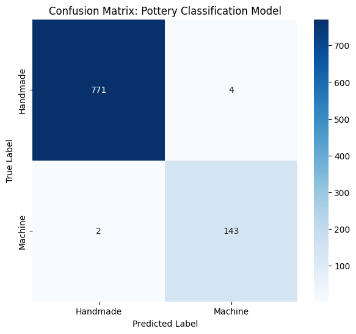
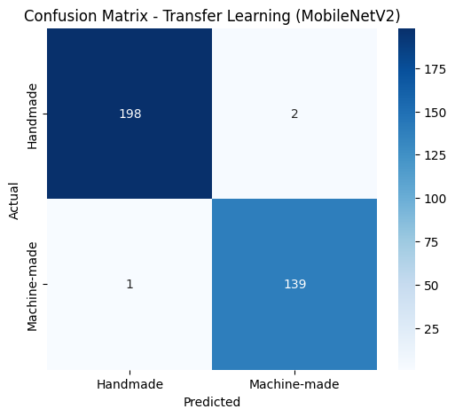
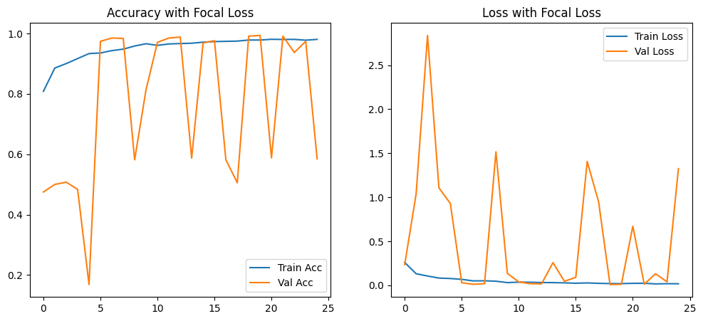

# AI-Driven Pottery Classification

Binary image classification of **handmade vs. machine-made pottery** with TensorFlow/Keras. The notebook builds an image dataset from public sources plus supplementary images, trains a **CNN from scratch** and a **MobileNetV2 transfer-learning** model, and evaluates both.

An individual academic project.

**Stack:** Python · TensorFlow/Keras · scikit-learn · NumPy · Matplotlib/Seaborn · Hugging Face `datasets` · Google Colab

## Project at a glance

| | |
|---|---|
| Task | Binary image classification (`0` = handmade, `1` = machine-made) |
| Input | RGB images resized to 224 × 224 |
| Models | Custom 4-block CNN · MobileNetV2 (frozen ImageNet backbone) |
| Notebook | [`AI-Driven-Pottery-Classification.ipynb`](AI-Driven-Pottery-Classification.ipynb) |
| Environment | Google Colab (notebook metadata lists a T4 GPU) |

## Dataset

| Source | Used for | Images |
|---|---|---|
| Hugging Face [`eddie-cui/Pottery-Like`](https://huggingface.co/datasets/eddie-cui/Pottery-Like) (train split) | Handmade | 3,851 |
| Hugging Face [`groove-net/kitchenware_5000_split`](https://huggingface.co/datasets/groove-net/kitchenware_5000_split) (train split), filtered to class IDs 0, 1, 4, 5, 6 | Machine-made | 522 |
| Supplementary image archives (`Handmade_New.zip`, `Machine_New.zip`, `Machine_New2.zip`) | Handmade / machine-made | 50 / 175 |
| **Merged dataset** | | **4,598** (3,901 handmade / 697 machine-made) |

The notebook comments identify kitchenware class IDs 0 = bowl, 1 = cup and 4 = plate; IDs 5 and 6 were added to increase the machine-made sample count. Check each dataset's page for its license and terms before reuse.

## Methodology

1. **Loading and filtering:** both Hugging Face datasets are loaded; machine-made images are filtered by class ID.
2. **Preprocessing:** every image is converted to RGB and resized to 224 × 224; supplementary images are merged in and the full array is saved as `pottery_data_full.npz`.
3. **Model A, CNN from scratch**
   - 4 × [Conv2D (32/64/128/256 filters) → BatchNorm → MaxPool], then Dense(512) + BatchNorm + Dropout(0.5) and a sigmoid output.
   - Augmentation: rotation, shifts, shear, zoom, horizontal flip.
   - `BinaryFocalCrossentropy` (γ=2, α=0.25), Adam (lr 1e-4), 25 epochs, batch size 32; best-validation-accuracy checkpoint kept.
   - 80/20 split → 3,678 training / 920 validation images.
4. **Model B, MobileNetV2 transfer learning**
   - Frozen ImageNet backbone → GlobalAveragePooling2D → Dense(1, sigmoid); Adam, binary cross-entropy, 5 epochs, batch size 16.
   - Class-balanced subset (1,000 handmade + all 697 machine-made), stratified 80/20 split → 1,357 training / 340 test images.
5. **Evaluation:** classification reports, confusion matrices, and predictions on four external photos.

## Results reported by the notebook

These numbers come from the original Colab run saved in the notebook. They were not re-run for this repository.

| Model | Evaluation set | Accuracy | Confusion matrix (rows = actual) |
|---|---|---|---|
| CNN from scratch | 920-image validation split (775 handmade / 145 machine-made) | 0.99 | handmade 771 / 4 · machine 2 / 143 |
| MobileNetV2 | 340-image stratified test split (200 / 140) | 0.9912 | handmade 198 / 2 · machine 1 / 139 |

<p>
  
  
</p>



**External image test.** The CNN checkpoint was also run on four photos that are not part of the dataset. Saved predictions: `handmade.jpg` → Handmade (61.35%), `handmade1.jpg` → Handmade (69.20%), `Machinmade.jpg` → Machine-made (99.63%), `Machinmade1.jpg` → Machine-made (78.81%). This is a small qualitative check, not a benchmark.

## Limitations

- **Dataset source:** handmade and machine-made images come from different source datasets, so high scores may partly reflect differences between the datasets rather than craftsmanship alone. The results show the pipeline works on this data; they are not evidence of real-world generalization.
- **Evaluation setting:** the CNN checkpoint was chosen using the same validation split it is reported on, and its validation accuracy varies considerably between epochs in the saved log. The MobileNetV2 test set is small (340 images).
- The notebook was run once; no repeated runs or cross-validation were performed.

## Required files (not included in this repository)

The repository is intentionally lightweight. The following are stored in the author's Google Drive and are **not** in this repo:

| File | Needed for |
|---|---|
| `Handmade_New.zip`, `Machine_New.zip`, `Machine_New2.zip` | Supplementary images (notebook step 4) |
| `pottery_data_full.npz` | Output of the merge step; input of the MobileNetV2 section |
| `best_cnn_scratch_v4.keras` | Trained CNN checkpoint; input of the evaluation cells |
| `handmade.jpg`, `handmade1.jpg`, `Machinmade.jpg`, `Machinmade1.jpg` | External test photos |

Without the three archives the notebook still downloads the public Hugging Face images, but the merged dataset will differ from the one described above and the reported numbers will not be reproduced exactly.

## Setup

1. Open the notebook in Google Colab (GPU runtime recommended), or locally with Python 3.10+ and `pip install -r requirements.txt` (the Drive cells are Colab-only).
2. Run the cells in order. The Hugging Face datasets are public and download without a token (the notebook prints an optional `HF_TOKEN` warning).

### Google Drive setup (template, untested)

The notebook mounts Drive in its first cell but reads files from the Colab working directory (`/content`). To use your own copies, add a cell after the Drive mount that copies them across (replace `<your-folder>`):

```python
DRIVE_DIR = "/content/drive/MyDrive/<your-folder>"
!cp "$DRIVE_DIR/Handmade_New.zip" "$DRIVE_DIR/Machine_New.zip" "$DRIVE_DIR/Machine_New2.zip" /content/
# Optional: reuse earlier outputs instead of rebuilding them
!cp "$DRIVE_DIR/pottery_data_full.npz" "$DRIVE_DIR/best_cnn_scratch_v4.keras" /content/
```

Notes: the MobileNetV2 section only needs `pottery_data_full.npz`. The CNN evaluation cell also needs `X_val` / `y_val`, which are created in the CNN training cell, so run that split (or the whole cell) first. This template has not been executed as written.

## Repository structure

```
AI-Driven-Pottery-Classification/
├── AI-Driven-Pottery-Classification.ipynb   # notebook with original code and saved outputs
├── assets/                                  # figures extracted from the notebook outputs
├── requirements.txt
└── README.md
```

The notebook code is unchanged from the original; markdown documentation cells were added. Some code comments are in Arabic.
